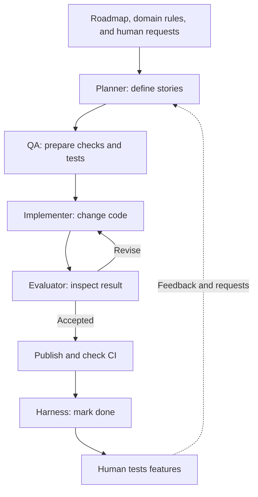

# AI-assisted development workflow

This workflow develops the GW2 crafting application against an existing roadmap and domain specification. AI agents plan small implementation tasks, prepare tests, write code, and review the result. Python controls task selection and completion; the human Product Owner directs product behavior and can change scope through requests.

An **agent** here is a model running with tools and a specific role. The workflow service invokes one role at a time, in a sequence of work and checks.

A local Python workflow service schedules the work, invokes agents, records progress, and applies the retry rules. Tests and GitHub Actions check the implementation. Missing product rules become questions for a human; unrelated work can continue. The automated implementation leaves the maintainer more time to test features and feed bugs and ideas back into planning.

The project began with AI-assisted pair programming, then paused after recurring bugs and tangled business logic made progress difficult. The maintainer established the specifications and roadmap before starting with Codex as Planner and Claude as coder. The later roles and safeguards grew from practical problems. Grafana provides the workflow visualization; the [history](docs/EVOLUTION.md) explains why the earlier n8n layer was dropped.

Claude's usage allowance is currently the implementation bottleneck on the maintainer's reported $20 plan. Codex allowance is not currently a constraint. Work on reducing Claude usage is still under investigation; the budget controls pace consumption but do not remove that limit.

The reading guides below live in **`agent/docs/`**. Role instructions in `agent/`, such as `ARCHITECT_INSTRUCTIONS.md`, are execution contracts. Use these direct links for explanations of the system.

| Start with | What it explains |
| --- | --- |
| [agent/docs/ARCHITECTURE.md](docs/ARCHITECTURE.md) | How this implementation works, why its boundaries exist, and document ownership. |
| [agent/docs/COMPARISON.md](docs/COMPARISON.md) | Single-agent and multi-agent approaches, their costs, limitations, and suitability. |
| [agent/docs/WORKFLOW_DIAGRAMS.md](docs/WORKFLOW_DIAGRAMS.md) | Milestone execution, human testing and feedback, decision authority, and failures. |
| [agent/docs/EVOLUTION.md](docs/EVOLUTION.md) | The maintainer's account and a few supporting Git snapshots. |

For operation and code details, use the [workflow service guide](../workflow_service/README.md) and [runtime guide](runtime/README.md).
