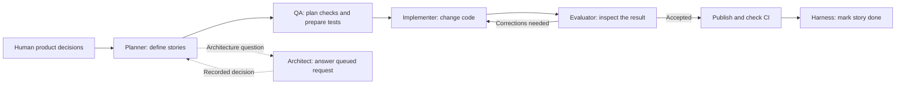

# AI-assisted development workflow

This workflow turns product requests and a roadmap into small implementation tasks for the GW2 crafting application. AI agents plan, prepare tests, write code, and review the result. Python controls task selection and completion; the human Product Owner decides product behavior.

An **agent** here is a model running with tools and a specific role. The roles run in separate invocations, through one bridge task at a time. This is a sequence of work and checks, rather than several developers coding in parallel.

n8n schedules the work and calls a local Python bridge. The bridge runs the agents, records progress, enforces file boundaries, and handles retries. Tests and GitHub Actions check the implementation. Missing product rules become questions for a human; unrelated work can continue.

The split grew from a workflow centered on one coding agent. It makes requirements, implementation, and review separate responsibilities. That costs additional model calls, handoffs, and runtime maintenance. A simpler coding agent with tests and human review can be a better fit for bounded work. The documents below explain where this implementation earns its complexity and where its limits remain.

| Start with | What it explains |
| --- | --- |
| [Architecture and alternatives](docs/ARCHITECTURE.md) | How the components interact, why the boundaries exist, document ownership, and comparison with simpler or more dynamic workflows. |
| [Workflow diagrams](docs/WORKFLOW_DIAGRAMS.md) | A milestone from request to completion, decision authority, and what happens on failure. |
| [Design evolution](docs/EVOLUTION.md) | A few Git snapshots and recorded problems behind the current design. |
| [Glossary](docs/GLOSSARY.md) | Terms used here, including agents, stories, context, and the harness. |

For operation and code details, use the [bridge guide](../local_bridge/README.md) and [runtime guide](runtime/README.md). The [experimental README archive](agent_README_experimental_archive.md) preserves earlier design notes; it is not the current operating contract.
