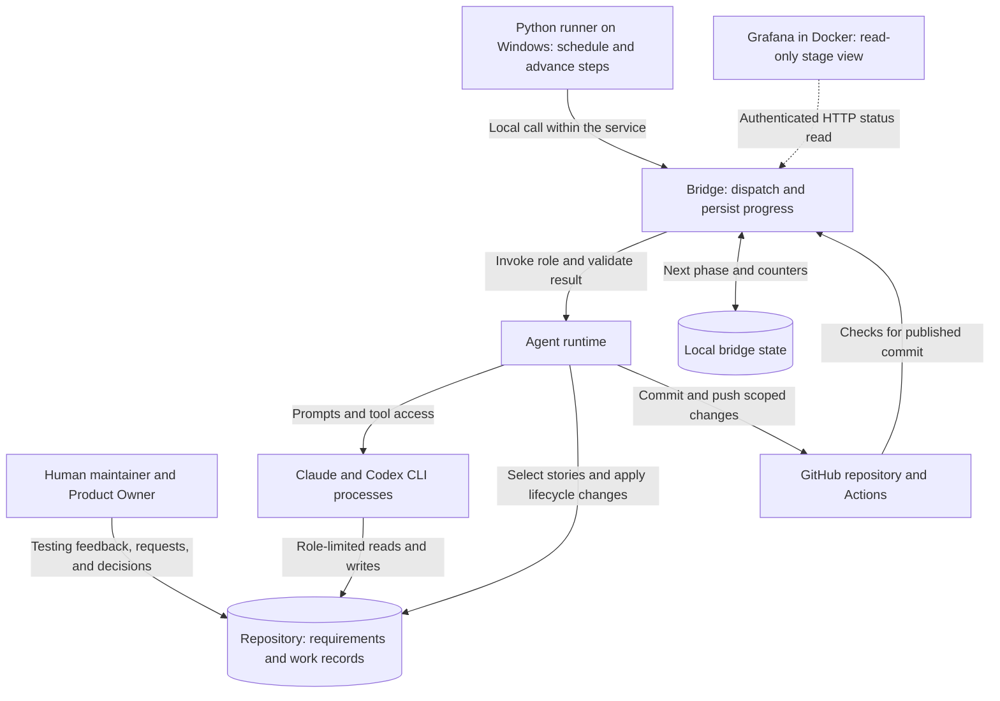
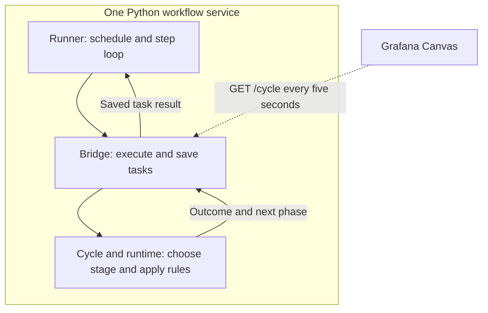

# System architecture

## The system in plain terms

The workflow manages changes to a software product across multiple tasks. Its roadmap, domain specification, architecture documents, and initial problem list were established before the automated workflow started. A Planner turns the current roadmap phase into stories: bounded tasks with acceptance criteria. QA prepares checks before coding. An Implementer changes the repository, and an Evaluator inspects the result. Python decides which task may run next and when its status may change.

The human continues steering the product while it is being built. Testing implemented features produces bug reports, ideas, and requested behavior changes. Product Owner requests bring that feedback into planning; they are not the origin of every milestone. The [feedback diagram](WORKFLOW_DIAGRAMS.md#human-testing-and-scope-changes) shows that route, and [the comparison](COMPARISON.md) evaluates alternatives to this implementation.

This matters for a crafting application because a plausible result can still use the wrong domain rule. For example, a passing calculation test does not establish that the tested rule is the intended rule, or that the browser reaches that calculation. The design gives requirement questions, test preparation, and review explicit places in the workflow. It cannot make an incorrect specification correct.

### Components and communication

### Execution and visibility

The runner, bridge and cycle are Python modules within one host service, not separate servers. The runner calls the bridge directly; the bridge uses the existing cycle and runtime to do the work. Grafana reads host status over HTTP; the execution loop makes no HTTP step requests. Claude and Codex still run as separate CLI processes.

| Part | Owns | Why it lives there |
| --- | --- | --- |
| **Python runner** | Nightly starts, waiting for tasks, continuing or stopping a run, and the 200-step guard. | Replaces n8n's generic loop without duplicating the stage rules. |
| **Bridge** | One active task, persisted task/cycle/budget state, the budget refresh worker, and authenticated status/configuration endpoints. | Keeps execution and its records under one state owner; Grafana can inspect them without driving work. |
| **Cycle and agent runtime** | Stage selection, agent invocation, validation, file protection, lifecycle changes, Git, and CI handling. | Keeps repository rules in testable Python code, with one definition of eligibility and retry policy. |
| **Grafana** | A Canvas view of current activity and recent active-story events. | Provides an editable stage diagram without implementing the workflow again in a browser application. |

The runner starts hourly at `:35` from `17:35` through `06:35`, using the host's local timezone. A run continues while completed tasks return `proceed: true`; a budget wait, empty queue, decision or failure can stop it. Long tasks are polled locally, with no n8n callback. The start window does not interrupt a running task, and missed starts while the service is off are not replayed. The [run-control diagram](WORKFLOW_DIAGRAMS.md#starting-continuing-and-stopping-a-run) shows these decisions.

Grafana reads `GET /cycle` through its data source. The dashboard prioritizes the running task over the saved next phase: for example, it can show planning while the active story remains at `implement` awaiting Claude capacity. Blue indicates running work; amber indicates waiting, red needs attention, green records completion, and gray has no result. Completion of a stage is not proof of correctness. Arrows are explanatory and never execute a transition.

The Canvas is a maintained view of the known stages, not a graph generated from Python code. Adding or renaming a stage may require a dashboard edit; changing its internal implementation need not. It shows active-story history rather than a complete project timeline. Agent tool calls and coding output still require the console or runtime records. Budget state is exposed by the service but has no dashboard panel or editing control yet.

The reason for this split is the maintainer's need to see which role is working without maintaining the same policy in a visual execution graph. The old n8n canvas displayed a generic request/wait loop even when Python was planning, coding or evaluating. Python now owns the outer loop too; Grafana supplies the separate view. This removes n8n's callback and schedule dependency after deployment, but leaves the custom Python engine to maintain and adds Grafana configuration to operate. The [comparison](COMPARISON.md#execution-and-visibility-are-separate-choices) considers the alternatives.

These changes are implemented on this branch; they do not themselves replace the live n8n service. The [cutover guide](../../local_bridge/README.md#cutover-from-n8n) covers preserving in-flight work and disabling both n8n schedules. Legacy callbacks and [workflow exports](../../local_bridge/workflows/GW2-Development-Pipeline.json) remain for rollback. The [Grafana guide](../../workflow_monitor/README.md) covers setup and dashboard persistence.

## Why the responsibilities are separate

These are reasons for the mechanisms, not claims that they eliminate the underlying risks. [Design evolution](EVOLUTION.md) distinguishes documented incidents from architectural reasoning.

| Problem or constraint | Mechanism and reasoning | Cost or remaining limit |
| --- | --- | --- |
| Product rules must not be chosen for coding convenience. | The Planner defines bounded stories; the Implementer works within them. Product ambiguities require a human User Decision. Architecture questions use a separate Architect invocation. | A story can still misinterpret intent. Unnecessary questions delay work; a model can fail to recognize a real ambiguity. |
| A completion report is a claim about code. | A separate Evaluator reads the working tree, acceptance criteria, and QA plan. It can request concrete corrections without changing the implementation. | Review adds model usage and latency. Different roles or vendors do not establish statistically independent judgments; both can share a mistaken assumption. |
| Tests prepared after coding can merely confirm the chosen implementation. | QA prepares a persistent plan and may write tests first. The harness restores QA-owned tests and plan contents if coding changes them. | QA can choose weak tests or a wrong expectation. Restoration protects the agreed test contract, not its semantic correctness. Conditional read-only QA review handles disputed or insufficient verification. |
| Queue selection and status changes have precise rules. | Python checks eligibility and owns lifecycle changes. The Planner requests backlog additions, moves, and reordering through JSON `backlog_actions`; the writer derives and validates index entries. | Validation can check structure and dependencies, not prove that prioritization or acceptance criteria are good. The runtime itself needs maintained tests. |
| Long-running work can be interrupted or hit a usage limit. | Persisted phases and counters let the bridge resume at a step boundary. Capacity waits keep the phase; actual failures use separate retry budgets. | An interrupted step may run again. File and Git side effects require recovery handling; saving JSON does not provide a transaction over the whole workflow. |
| Maintainer edits can arrive while an agent is implementing. | The pipeline uses an `agent/dev` worktree. Between stories it merges `origin/master` and reviews incoming changes against their owning documents. | Branch isolation prevents sharing a working tree, not semantic or merge conflicts. Sync, review, and publication add code and operational failure modes. |

The separation is useful only while the additional checks catch enough relevant problems to justify their overhead. A read-only Evaluator cannot fix a defect itself; every correction requires another handoff. A narrow change can therefore spend more time in preparation and review than in coding.

## Human feedback and changes of scope

The initial roadmap supplied rough milestones. Their details can be refined as work approaches, while product requests can add ideas, report bugs, or change intended behavior during development. The Planner reconciles a request with existing coverage, updates the owning requirement or planning document, and creates work when the phase rules permit it. A later-phase request is retained as future work rather than automatically bypassing the current phase.

This keeps requests actionable without using the request itself as a second requirements store. The Planner's resolution records where the intent is represented. User Decisions serve a different purpose: agents ask the human to settle missing or conflicting behavior. User Interventions record a need for human attention when execution cannot proceed automatically. See the [Product Owner request contract](../PLANNER_INSTRUCTIONS.md#product-owner-requests) for exact processing rules.

### Researching game mechanics

The maintainer permits both Planner and QA to consult the Guild Wars 2 Wiki when their current work depends on game mechanics. QA's [external-facts guidance](../QA_INSTRUCTIONS.md#external-facts-and-ambiguity) already includes the wiki. Relevant research should retain the source URL and supported claim and distinguish game facts from choices about what this application should do. Research can establish a recipe mechanic; it cannot decide an unspecified valuation or product policy. Conflicts with confirmed product requirements still need the appropriate human decision.

### Current implementation bottleneck

The maintainer reports using a $20 Claude plan and frequently exhausting its allowance. Claude coding capacity is currently the bottleneck; Codex allowance is not currently a constraint in this setup. This is the maintainer's operating experience, not a price guarantee or a claim that Codex has no limits.

The implementation checks Claude's session and weekly allowance before coding. It does not reserve capacity for the whole run or stop a run at the threshold. While Claude waits, triggered Codex planning and architecture work can continue. The quota controls pace the available allowance; they do not increase it. Reducing Claude usage remains under investigation. The [comparison's cost section](COMPARISON.md#cost-and-the-current-bottleneck) distinguishes that practical constraint from general trade-offs between workflow designs.

Budget settings and the latest usage reading now persist in the service's state file. A worker refreshes at startup and every quarter-hour. That cached result is for observation; coding still requires a fresh check. Manual overrides remain available through authenticated `POST /budget`, replacing the n8n table as the live configuration source after cutover. The [budget guide](../../local_bridge/README.md#claude-budget) owns the exact limits and reset rules.

## Documentation ownership is part of the design

Two different questions matter: **where does a fact belong**, and **who may change that file**? The [documentation map in `CLAUDE.md`](../../CLAUDE.md#documentation-map) answers the first. [`DOCUMENT_OWNERSHIP` in `config.py`](../runtime/support/config.py) and the role contracts define write authority. This overview is a reading guide, not a second permission table.

| Reader's question | Authoritative home |
| --- | --- |
| What should the product do, and what should its player-facing terms mean? | [Domain specification](../../docs/DOMAIN_SPEC.md) and [crafting glossary](../../docs/crafting/GLOSSARY.md). |
| What exists now, and what architecture is intended? | [Current state](../../docs/CURRENT_STATE_SPEC.md), [current architecture](../../docs/CURRENT_ARCHITECTURE.md), and [target architecture](../../docs/TARGET_ARCHITECTURE.md). Current implementation alone does not decide intended behavior. |
| What work remains, and what does one task require? | [Roadmap](../../docs/ROADMAP.md), [known problems](../../docs/KNOWN_PROBLEMS.md), [backlog index](../stories/BACKLOG.md), and the linked story contracts. [Project state](../PROJECT_STATE.md) carries Planner continuity. |
| What standards apply to implementation and verification? | [Coding guidelines](../../docs/CODING_GUIDELINES.md), [test strategy](../../docs/TEST_STRATEGY.md), and the story's [persistent QA plan](../qa-plans/README.md). |
| Who decided an unresolved question? | [User Decisions](../user-decisions/), [Architect Requests](../architect-requests/), and [architecture decision records](../../docs/architecture/decisions/). |

Keeping intended and observed behavior separate is necessary when they disagree. A maintainer may intentionally change code without updating its descriptive documentation. The sync review can reconcile a stale description; it may not silently rewrite an authoritative domain rule or target decision to match the code. It raises the appropriate question instead. Copying the same rule into several overviews would create more places for disagreement.

The harness alone changes the active-story pointer and mechanical status transitions. The Planner can maintain the roadmap within its contract, but cannot resolve human decisions or act as the Architect. QA can write tests in approved roots; the Evaluator is read-only. The documentation sync review has its own bounded write policy in [`sync_review.py`](../runtime/core/sync_review.py). These are different permissions, not a single rule that every non-coding role is read-only.

## Implementation details and limits

### State and recovery

| Record | Purpose and lifetime |
| --- | --- |
| Service `tasks.json` | Task records, next phase, retry counters, changed paths, published SHA, planning continuity, budget settings/readings, and runner checkpoints. `GW2_BRIDGE_STATE` selects the path; the default is `%USERPROFILE%/.gw2-claude-bridge/tasks.json`, outside Git. |
| `CURRENT_STORY.md` and `BACKLOG.md` | Tracked active-story pointer and queue index. Eligibility also checks the canonical story and its prerequisites. |
| `agent/qa-plans/` | Tracked QA contracts and review records used across coding attempts. |
| `agent/runtime/artifacts/` | Ignored generated prompts, results, and backups for the current runtime. These are not authoritative requirements. |
| `agent/logs/` | Tracked append-only daily operational history, separate from generated artifacts. |
| Grafana Docker volume | Dashboard edits, data-source settings and Grafana accounts; separate from project execution state. The saved dashboard JSON is a versioned design, not an automatic export of UI edits. |

Progress is recorded outside the live model conversation and independently of Grafana. The bridge saves JSON through a temporary file and atomic replacement. Task creation and the runner's task identity/attempt counter are saved together before work starts. That avoids exposing a partially rewritten file, but does not make a whole stage's file edits, model calls, and Git operations one transaction. An OS file lock rejects another updated service using the same state path; Python-driver mode also rejects n8n or manual HTTP task starts.

| Interruption | How work resumes | Limit |
| --- | --- | --- |
| Grafana or its connection stops | The Python workflow continues. Grafana reads current state when it reconnects. | The dashboard is unavailable during the outage; it does not retain a complete execution history. |
| A normal Ctrl+C stops the Python runner | Scheduling stops and the current step is allowed to finish. An unfinished run's saved checkpoint is retained for restart. | Shutdown can take as long as the model call or CI wait. |
| The service is forcibly stopped or the host restarts | Running tasks are marked interrupted. An active Python run resumes automatically, even outside the start window, and retries through the existing phase recovery. Interrupted coding uses a continuation prompt and its captured baseline. | Recovery is at stage boundaries. Work may repeat; a force-kill does not prove that child processes or external effects stopped. |
| Legacy n8n stops before cutover | A later n8n execution can reattach to the bridge's still-running task. | This is the legacy driver path, not a dependency of the Python runner. |
| An agent exhausts capacity or fails | Capacity waits retain the phase. Other failures follow that stage's retry or blocking rules; validated plans and completed work are reused where the recovery path supports it. | An incomplete model response is not a completed result. Uncommitted edits can need inspection before another attempt. |

The daily log in `agent/logs/` records completed step outcomes, reasons, and workflow warnings. Together with saved tasks and runner stop reasons, prompts and results in `artifacts/`, and the repository diff, it helps reconstruct where a run diverged from expectations. It is a decision trail, not a complete agent transcript; streamed coding output goes to the service console, and generated artifacts may be overwritten by later runs. These records make it possible to investigate a failure and target a change to the responsible workflow stage instead of restarting the project without understanding the cause.

Recovery can preserve finished work and return a derailed run to a coherent point: reuse a validated QA plan, retry evaluation without repeating completed coding, or reconcile the active-story pointer, backlog, and cycle record. Git history also allows tracked files to be recovered from earlier versions. The runtime already restores specific protected files around agent attempts, but a full rollback of the project and its execution state is a maintainer action, not an automatic time-travel feature. The local cycle file and ignored artifacts are outside Git; recovering an earlier combination requires those records or backups as well as matching tracked files. There is no guarantee of zero lost progress after every failure.

The [bridge recovery guide](../../local_bridge/README.md#recovering-by-hand) describes how to reconcile state, and the [runtime guide](../runtime/README.md#resuming-an-interrupted-step) explains saved attempts. Completion requires a usable verdict, publication, and the CI step; the code allows CI verification to be `SKIPPED` when unavailable, so DONE does not unconditionally mean CI passed.

### Branch integration and document review

The normal launcher uses the separate `agent/dev` worktree. Between stories, `sync` merges `origin/master`, at most once per 30-minute interval. A merge conflict is aborted and stops the run; a merge that would overwrite uncommitted work is deferred. Incoming changes beyond the dependency-only filter receive a bounded Codex `review` pass. It can update approved descriptive docs, open decisions or architecture requests, record problems, and give findings to the Planner. It cannot change application code or settle a product contradiction. Two invalid review attempts leave a workflow warning and the range for Planner attention.

After scoped publication and the CI step, finalization records DONE and pushes lifecycle updates on the agent branch, then attempts to fast-forward `master`. If `master` moved incompatibly, the push is rejected without force; the story remains complete on the agent branch and a warning records the outstanding integration. The next sync and story can carry both histories. This is branch publication, not proof of deployment to a running application.

The most useful code entry points are the [runner and schedule](../../local_bridge/run_cycle.py), [executor and status API](../../local_bridge/bridge.py), [`choose_step()` and stage functions](../../local_bridge/cycle.py), [Git synchronization](../runtime/support/git_sync.py), [sync review](../runtime/core/sync_review.py), [backlog actions](../runtime/core/backlog_writer.py), and [QA/evaluation details in the runtime guide](../runtime/README.md). The [service guide](../../local_bridge/README.md#branches) covers the actual worktrees and commands.
