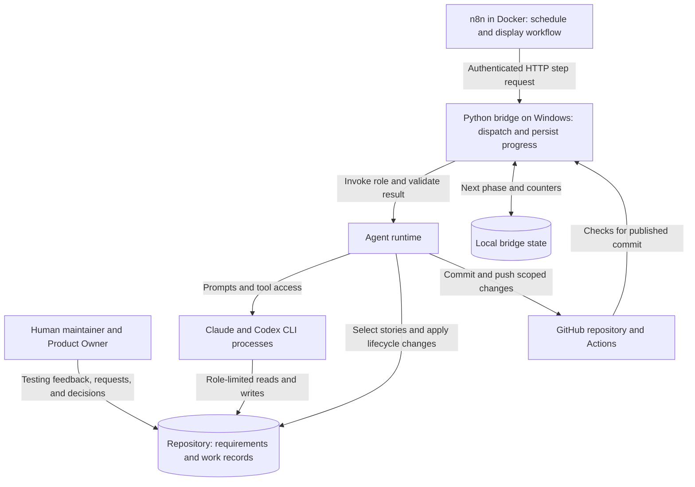

# System architecture

## The system in plain terms

The workflow manages changes to a software product across multiple tasks. Its roadmap, domain specification, architecture documents, and initial problem list were established before the automated workflow started. A Planner turns the current roadmap phase into stories: bounded tasks with acceptance criteria. QA prepares checks before coding. An Implementer changes the repository, and an Evaluator inspects the result. Python decides which task may run next and when its status may change.

The human continues steering the product while it is being built. Testing implemented features produces bug reports, ideas, and requested behavior changes. Product Owner requests bring that feedback into planning; they are not the origin of every milestone. The [feedback diagram](WORKFLOW_DIAGRAMS.md#human-testing-and-scope-changes) shows that route, and [the comparison](COMPARISON.md) evaluates alternatives to this implementation.

This matters for a crafting application because a plausible result can still use the wrong domain rule. For example, a passing calculation test does not establish that the tested rule is the intended rule, or that the browser reaches that calculation. The design gives requirement questions, test preparation, and review explicit places in the workflow. It cannot make an incorrect specification correct.

### Components and communication

n8n runs in Docker; the bridge runs on the Windows host in the pipeline's worktree. The bridge and agent runtime are both Python code. They are separate responsibilities, not separate programming languages or two independent orchestration services. The runtime modules are called by the bridge and launch the Claude and Codex command-line processes when a step needs a model.

### Who does what, and why?

| Part | Responsibility | Reason for the boundary |
| --- | --- | --- |
| **n8n** | Starts scheduled or manual executions, reads budget settings, requests steps, waits for completion, records returned results, and decides whether to request another step. | Makes the execution path and each returned result visible to the maintainer. The graph provides a way to inspect a run without following the Python call stack. |
| **Bridge — `local_bridge/bridge.py`** | Exposes the authenticated HTTP interface, accepts one task at a time, dispatches work, saves task and cycle records, and sends completion callbacks to n8n. | Connects the containerized workflow to the host checkout, installed agent CLIs, and local execution state. It also lets a replacement n8n execution re-attach to work already running. |
| **Cycle policy — `local_bridge/cycle.py`** | Chooses the next stage from saved state and planning triggers, applies transitions, and distinguishes correction, capacity waits, blocking, and completion. | Keeps story lifecycle rules in testable Python functions. The model does not choose its own next role, and n8n does not maintain a second copy of story eligibility or retry policy. |
| **Agent runtime — `agent/runtime/`** | Builds prompts, runs agent processes, validates their outputs and file changes, protects QA artifacts, and supplies planning, story-state, Git, and CI helpers. | Centralizes the project-specific rules used by the cycle instead of rebuilding them in workflow nodes or leaving them to a model's interpretation. |

The Python code enforcing these boundaries is referred to as the harness. A role can make several model requests and tool calls during one bridge task, but the bridge does not run competing coding tasks against the same files.

### Reading the n8n workflow

The graph is a step-request loop. It does not contain a separate node for every Planner, QA, or coding invocation. **Run Next Step** asks the bridge to do whichever stage Python considers due. That might be a maintainer sync, a planning pass, QA preparation, coding, evaluation, publication, a CI check, or finalization. The returned `step`, `outcome`, `reason`, and `phase` explain what actually ran.

*Screenshot placeholder: [`images/n8n-development-pipeline.png`](images/n8n-development-pipeline.png) is currently empty. Replace it with an image of the n8n **GW2 - Development Pipeline** canvas. Include the path from **Read Budget Settings** through **Run Next Step**, **Wait for Step**, **Record Step**, and **Continue?** so the request loop is visible.*

The screenshot will show the visible loop; the following example explains what passes between its nodes and the Python process:

1. **Read Budget Settings** loads the Claude budget row. **Run Next Step** sends it to `POST /cycle/step`, along with the resume URL of n8n's Wait node.
2. The bridge checks for an existing task. If one is running, it re-attaches the new callback URL instead of starting another. Otherwise, Python chooses the next stage and creates a task record.
3. Short stages can return a finished result immediately. Long stages, such as coding or evaluation, return `running` while the bridge executes them in a background thread. **Step Running?** routes that execution to **Wait for Step**.
4. When the stage finishes, Python saves the outcome and next phase, then the bridge calls the Wait node's resume URL. n8n continues to **Record Step**, where the returned fields can be inspected.
5. **Continue?** uses the result's `proceed` flag to loop or stop. For example, an actionable evaluation retry changes the saved phase to `implement` and permits another step. A Claude capacity wait leaves that phase in place and stops the current n8n run until a later attempt.

The saved phase belongs to the Python bridge state, not to the position of a node on the canvas. A Wait timeout or restarted n8n execution can therefore re-attach to the same running task. A bridge-process restart is different: it interrupts the task, and recovery repeats the saved step. The [state and recovery section](#state-and-recovery) explains the records involved.

### Why keep Python after moving to n8n?

The move addressed visibility and control after the Python orchestrator became difficult for the maintainer to follow. n8n exposes the request loop, waits, and returned information in an execution view. Python remains responsible for precise repository rules: which story is eligible, which files a role may change, how a verdict is validated, and what a particular failure means. Moving those rules into canvas nodes would still require implementing and maintaining them, with the risk of splitting the same policy across two places.

This division has a limit: the n8n canvas is not a complete trace of an agent's internal tool use or every Python function. Step results give the maintainer the decision trail; deeper investigation uses the bridge console, [runtime artifacts and logs](#state-and-recovery), and source code. The HTTP connection, callback delivery, saved state, and two running services also add operational work. The [bridge guide](../../local_bridge/README.md#running-the-pipeline) documents the actual execution and recovery procedures; the [exported n8n workflow](../../local_bridge/workflows/GW2-Development-Pipeline.json) records the canvas configuration.

The system combines a fixed outer workflow with agents that choose how to perform their assigned task. Using Anthropic's [workflow and agent terminology](https://www.anthropic.com/engineering/building-effective-agents), the outer structure is a coded workflow; its coding and planning steps contain agent loops. It also uses an evaluator/implementation feedback loop. These patterns do not require different model vendors or parallel execution.

For the actual stage dispatch, see [`cycle.py`](../../local_bridge/cycle.py) and [`bridge.py`](../../local_bridge/bridge.py). The [workflow diagrams](WORKFLOW_DIAGRAMS.md) show task flow and failure handling without the HTTP details.

## Why the responsibilities are separate

These are reasons for the mechanisms, not claims that they eliminate the underlying risks. [Design evolution](EVOLUTION.md) distinguishes documented incidents from architectural reasoning.

| Problem or constraint | Mechanism and reasoning | Cost or remaining limit |
| --- | --- | --- |
| Product rules must not be chosen for coding convenience. | The Planner defines bounded stories; the Implementer works within them. Product ambiguities require a human User Decision. Architecture questions use a separate Architect invocation. | A story can still misinterpret intent. Unnecessary questions delay work; a model can fail to recognize a real ambiguity. |
| A completion report is a claim about code. | A separate Evaluator reads the working tree, acceptance criteria, and QA plan. It can request concrete corrections without changing the implementation. | Review adds model usage and latency. Different roles or vendors do not establish statistically independent judgments; both can share a mistaken assumption. |
| Tests prepared after coding can merely confirm the chosen implementation. | QA prepares a persistent plan and may write tests first. The harness restores QA-owned tests and plan contents if coding changes them. | QA can choose weak tests or a wrong expectation. Restoration protects the agreed test contract, not its semantic correctness. Conditional read-only QA review handles disputed or insufficient verification. |
| Queue selection and status changes have precise rules. | Python checks eligibility and owns lifecycle changes. The Planner requests backlog additions, moves, and reordering through JSON `backlog_actions`; the writer derives and validates index entries. | Validation can check structure and dependencies, not prove that prioritization or acceptance criteria are good. The runtime itself needs maintained tests. |
| Long-running work can be interrupted or hit a usage limit. | Persisted phases and counters let the bridge resume at a step boundary. Capacity waits keep the phase; actual failures use separate retry budgets. | An interrupted step may run again. File and Git side effects require recovery handling; saving JSON does not provide a transaction over the whole workflow. |
| Maintainer edits can arrive while an agent is implementing. | The pipeline uses an `agent/dev` worktree. Between stories it merges `origin/master` and reviews incoming changes against their owning documents. | Branch isolation prevents sharing a working tree, not semantic or merge conflicts. Sync, review, and publication add code and operational failure modes. |

The separation is useful only while the additional checks catch enough relevant problems to justify their overhead. A read-only Evaluator cannot fix a defect itself; every correction requires another handoff. A narrow change can therefore spend more time in preparation and review than in coding.

## Human feedback and changes of scope

The initial roadmap supplied rough milestones. Their details can be refined as work approaches, while product requests can add ideas, report bugs, or change intended behavior during development. The Planner reconciles a request with existing coverage, updates the owning requirement or planning document, and creates work when the phase rules permit it. A later-phase request is retained as future work rather than automatically bypassing the current phase.

This keeps requests actionable without using the request itself as a second requirements store. The Planner's resolution records where the intent is represented. User Decisions serve a different purpose: agents ask the human to settle missing or conflicting behavior. User Interventions record a need for human attention when execution cannot proceed automatically. See the [Product Owner request contract](../PLANNER_INSTRUCTIONS.md#product-owner-requests) for exact processing rules.

### Researching game mechanics

The maintainer permits both Planner and QA to consult the Guild Wars 2 Wiki when their current work depends on game mechanics. QA's [external-facts guidance](../QA_INSTRUCTIONS.md#external-facts-and-ambiguity) already includes the wiki. Relevant research should retain the source URL and supported claim and distinguish game facts from choices about what this application should do. Research can establish a recipe mechanic; it cannot decide an unspecified valuation or product policy. Conflicts with confirmed product requirements still need the appropriate human decision.

### Current implementation bottleneck

The maintainer reports using a $20 Claude plan and frequently exhausting its allowance. Claude coding capacity is currently the bottleneck; Codex allowance is not currently a constraint in this setup. This is the maintainer's operating experience, not a price guarantee or a claim that Codex has no limits.

The implementation checks Claude's session and weekly allowance before coding. It does not reserve capacity for the whole run or stop a run at the threshold. While Claude waits, triggered Codex planning and architecture work can continue. The quota controls pace the available allowance; they do not increase it. Reducing Claude usage remains under investigation. The [comparison's cost section](COMPARISON.md#cost-and-the-current-bottleneck) distinguishes that practical constraint from general trade-offs between workflow designs.

## Documentation ownership is part of the design

Two different questions matter: **where does a fact belong**, and **who may change that file**? The [documentation map in `CLAUDE.md`](../../CLAUDE.md#documentation-map) answers the first. [`DOCUMENT_OWNERSHIP` in `config.py`](../runtime/support/config.py) and the role contracts define write authority. This overview is a reading guide, not a second permission table.

| Reader's question | Authoritative home |
| --- | --- |
| What should the product do, and what should its player-facing terms mean? | [Domain specification](../../docs/DOMAIN_SPEC.md) and [crafting glossary](../../docs/crafting/GLOSSARY.md). |
| What exists now, and what architecture is intended? | [Current state](../../docs/CURRENT_STATE_SPEC.md), [current architecture](../../docs/CURRENT_ARCHITECTURE.md), and [target architecture](../../docs/TARGET_ARCHITECTURE.md). Current implementation alone does not decide intended behavior. |
| What work remains, and what does one task require? | [Roadmap](../../docs/ROADMAP.md), [known problems](../../docs/KNOWN_PROBLEMS.md), [backlog index](../stories/BACKLOG.md), and the linked story contracts. [Project state](../PROJECT_STATE.md) carries Planner continuity. |
| What standards apply to implementation and verification? | [Coding guidelines](../../docs/CODING_GUIDELINES.md), [test strategy](../../docs/TEST_STRATEGY.md), and the story's [persistent QA plan](../qa-plans/README.md). |
| Who decided an unresolved question? | [User Decisions](../user-decisions/), [Architect Requests](../architect-requests/), and [architecture decision records](../../docs/architecture/decisions/). |

Keeping intended and observed behavior separate is necessary when they disagree. A maintainer may intentionally change code without updating its descriptive documentation. The sync review can reconcile a stale description; it may not silently rewrite an authoritative domain rule or target decision to match the code. It raises the appropriate question instead. Copying the same rule into several overviews would create more places for disagreement.

The harness alone changes the active-story pointer and mechanical status transitions. The Planner can maintain the roadmap within its contract, but cannot resolve human decisions or act as the Architect. QA can write tests in approved roots; the Evaluator is read-only. The documentation sync review has its own bounded write policy in [`sync_review.py`](../runtime/core/sync_review.py). These are different permissions, not a single rule that every non-coding role is read-only.

## Implementation details and limits

### State and recovery

| Record | Purpose and lifetime |
| --- | --- |
| Bridge `tasks.json` | Task records, next phase, retry counters, changed paths, and published SHA. `GW2_BRIDGE_STATE` selects the path; the default is `%USERPROFILE%/.gw2-claude-bridge/tasks.json`, outside Git. |
| `CURRENT_STORY.md` and `BACKLOG.md` | Tracked active-story pointer and queue index. Eligibility also checks the canonical story and its prerequisites. |
| `agent/qa-plans/` | Tracked QA contracts and review records used across coding attempts. |
| `agent/runtime/artifacts/` | Ignored generated prompts, results, and backups for the current runtime. These are not authoritative requirements. |
| `agent/logs/` | Tracked append-only daily operational history, separate from generated artifacts. |

An n8n wait can re-attach to a still-running bridge task. A bridge restart instead interrupts that task; a later run repeats the step. Interrupted coding receives a continuation prompt and keeps its captured baseline. Completion requires a usable verdict, publication, and the CI step; the code allows CI verification to be `SKIPPED` when unavailable, so DONE is not an unconditional guarantee of a passing CI run. The [bridge guide](../../local_bridge/README.md) owns the operating and recovery procedures.

### Branch integration and document review

The normal launcher uses the separate `agent/dev` worktree. Between stories, `sync` merges `origin/master`, at most once per 30-minute interval. A merge conflict is aborted and stops the run; a merge that would overwrite uncommitted work is deferred. Incoming changes beyond the dependency-only filter receive a bounded Codex `review` pass. It can update approved descriptive docs, open decisions or architecture requests, record problems, and give findings to the Planner. It cannot change application code or settle a product contradiction. Two invalid review attempts leave a workflow warning and the range for Planner attention.

After scoped publication and the CI step, finalization records DONE and pushes lifecycle updates on the agent branch, then attempts to fast-forward `master`. If `master` moved incompatibly, the push is rejected without force; the story remains complete on the agent branch and a warning records the outstanding integration. The next sync and story can carry both histories. This is branch publication, not proof of deployment to a running application.

The most useful code entry points are [`choose_step()` and stage functions](../../local_bridge/cycle.py), [Git synchronization](../runtime/support/git_sync.py), [sync review](../runtime/core/sync_review.py), [backlog actions](../runtime/core/backlog_writer.py), and [QA/evaluation details in the runtime guide](../runtime/README.md). The [bridge guide](../../local_bridge/README.md#branches) covers the actual worktrees and commands.
