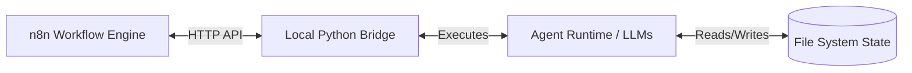
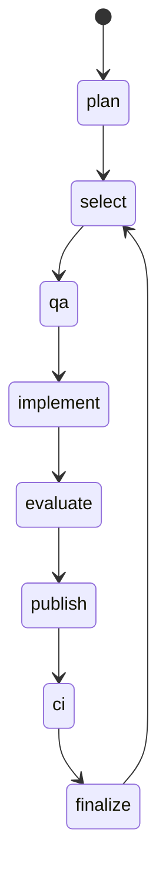

# System Architecture & Technical Design

The AI Orchestrator is a robust, file-backed state machine. This document explains the technical implementation of the bridge, state management, and the orchestration loop for engineers and developers maintaining the system.

## 1. High-Level Architecture

The system consists of three main operational tiers:

1.  **The Engine (n8n):** Runs in a Docker container. It handles the high-level workflow visualization, retries, and timing. It holds the "GW2 - Development Pipeline" workflow.
2.  **The Local Bridge (Python):** Runs on the host machine alongside the repository. It exposes an HTTP API (`/cycle`, `/cycle/step`, `/budget`) that n8n calls. The bridge is the authority on state transitions and executes the underlying Python logic.
3.  **The Agent Runtime (Python/LLMs):** The code under `agent/runtime/` that builds prompts, calls the LLM CLIs (`claude` and `codex`), parses outputs, and mutates the physical files (like updating the `BACKLOG.md` or writing to `agent/artifacts/`).

## 2. State Management (The Immutable Brain)

Unlike conversational LLM wrappers that rely on context windows to remember active tasks, the memory of this system is entirely externalized to physical files.

*   **`local_bridge/tasks.json`:** Tracks the current cycle phase (`plan`, `qa`, `implement`, etc.) and the token/budget status.
*   **`agent/CURRENT_STORY.md`:** A physical pointer to the active story being worked on.
*   **`agent/stories/BACKLOG.md`:** The authoritative index. Parsed deterministically via regex (in `story_state.py` and `backlog_writer.py`), ensuring the LLM cannot secretly drop or alter tasks.
*   **`agent/runtime/artifacts/`:** Stores the raw JSON/Markdown outputs from the latest LLM runs (e.g., `PLANNING_RESULT.json`, `EVALUATOR_RESULT.json`). These are transient and ignored by git, but crucial for debugging exact model outputs.

If execution is interrupted, the system reads `tasks.json` and `CURRENT_STORY.md` and resumes the exact phase.

## 3. The Orchestration Loop (Cycle Phases)

The `local_bridge/cycle.py` module defines the state machine. The execution flow follows these specific phases:

1.  **`plan`**: Runs the Codex model to evaluate the `ROADMAP.md` and `PROJECT_STATE.md`. It emits specific commands (`backlog_actions`) to add or move stories in the Backlog, or resolves Architect Requests.
2.  **`select`**: A purely deterministic Python step. It scans `BACKLOG.md` for the first eligible story in the `## To Do` section, sets it as `CURRENT_STORY.md`, and transitions to QA. If the queue is empty, it transitions back to `plan`.
3.  **`qa`**: The QA agent reads the story and authoritative docs, and outputs a JSON test plan. *Read-only.*
4.  **`implement`**: The Implementer (Claude) receives the QA plan, the story, and the codebase. It writes the code to the working tree.
5.  **`evaluate`**: The Evaluator (Codex) reads the Git working tree (the uncommitted changes) and compares them against the QA plan and Story requirements. If failures are detected, it transitions back to `implement` with a Retry prompt. *Read-only.*
6.  **`publish`**: Commits the dirty story scope to the active branch.
7.  **`ci`**: Waits for GitHub Actions to run the test suite against the published commit SHA. If CI fails, transitions back to `implement` with the CI error log.
8.  **`finalize`**: Marks the story as `DONE` in the backlog, clears `CURRENT_STORY.md`, and readies the queue for the next `select`.

## 4. Resource & Budget Throttling

Because this system runs autonomously, a failing loop could exhaust API account limits rapidly.

The `local_bridge/claude_budget.py` acts as a circuit breaker:
*   It parses the usage output from the Claude CLI.
*   It calculates "shares" based on the current day of the week and limits usage to a specific percentage cap.
*   If the system hits the cap, n8n pauses the `implement` step. While Claude is paused, the bridge intelligently uses the available time to run the `plan` step (using the unlimited Codex model) to groom the backlog.

## 5. Security & Document Ownership

The system enforces strict **Document Ownership** (`agent/runtime/support/config.py`).
*   The Planner is physically prevented by the Python harness from writing to application source code or modifying the Roadmap.
*   If an agent attempts to violate its write permissions, the harness raises an exception, rolls back the changes, and logs a validation failure.

## 6. Milestones and Roadmap Phases

The orchestrator derives its goals exclusively from `docs/ROADMAP.md`.
*   A specific "Phase N" in the roadmap maps directly to `milestone-NN` in the backlog.
*   The Planner is restricted to analyzing the *current* phase excerpt. It is not permitted to discover or redefine its own roadmap scope.
*   A milestone transition is only reported when the exit criteria defined in the roadmap for the current phase are fully satisfied, including project health reviews.
