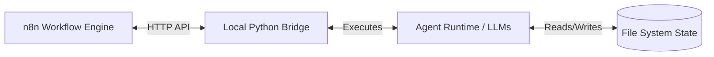
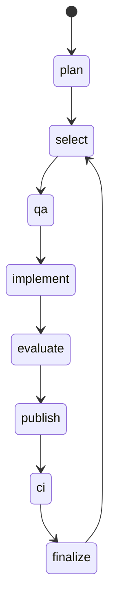

# Workflow architecture

The orchestrator uses a state machine backed by files. This document describes the bridge, stored state, and orchestration loop.

## 1. High-Level Architecture

The workflow runs through these components:

1.  **n8n:** Runs in a Docker container and hosts the "GW2 - Development Pipeline" workflow. It handles workflow visualization, retries, and timing.
2.  **The Local Bridge (Python):** Runs on the host machine alongside the repository. It exposes an HTTP API (`/cycle`, `/cycle/step`, `/budget`) that n8n calls. The bridge is the authority on state transitions and executes the underlying Python logic.
3.  **The Agent Runtime (Python/LLMs):** Code under `agent/runtime/` builds prompts, calls the LLM CLIs (`claude` and `codex`), parses outputs, and updates files such as `BACKLOG.md`.

## 2. Stored state

The runtime stores workflow state in files:

*   **`local_bridge/tasks.json`:** Tracks the current cycle phase (`plan`, `qa`, `implement`, etc.) and the token/budget status.
*   **`agent/CURRENT_STORY.md`:** Points to the active story.
*   **`agent/stories/BACKLOG.md`:** The authoritative work index, parsed by `story_state.py` and maintained through `backlog_writer.py`.
*   **`agent/runtime/artifacts/`:** Stores JSON/Markdown outputs from the latest LLM runs (e.g., `PLANNING_RESULT.json`, `EVALUATOR_RESULT.json`) for debugging. These files are transient and ignored by Git.

After an interruption, the system uses `tasks.json` and `CURRENT_STORY.md` to determine where to resume.

## 3. The Orchestration Loop (Cycle Phases)

`local_bridge/cycle.py` defines the state machine and its phases:

1.  **`plan`**: Runs the Codex model to evaluate the `ROADMAP.md` and `PROJECT_STATE.md`. It emits specific commands (`backlog_actions`) to add or move stories in the Backlog, or resolves Architect Requests.
2.  **`select`**: A purely deterministic Python step. It scans `BACKLOG.md` for the first eligible story in the `## To Do` section, sets it as `CURRENT_STORY.md`, and transitions to QA. If the queue is empty, it transitions back to `plan`.
3.  **`qa`**: The QA agent reads the story and authoritative docs, and outputs a JSON test plan. *Read-only.*
4.  **`implement`**: The Implementer (Claude) receives the QA plan, the story, and the codebase. It writes the code to the working tree.
5.  **`evaluate`**: The Evaluator (Codex) reads the Git working tree (the uncommitted changes) and compares them against the QA plan and Story requirements. If failures are detected, it transitions back to `implement` with a Retry prompt. *Read-only.*
6.  **`publish`**: Commits the dirty story scope to the active branch.
7.  **`ci`**: Waits for GitHub Actions to run the test suite against the published commit SHA. If CI fails, transitions back to `implement` with the CI error log.
8.  **`finalize`**: Marks the story as `DONE` in the backlog, clears `CURRENT_STORY.md`, and returns to `select`.

## 4. Resource & Budget Throttling

A repeated failure can consume the available model usage budget.

`local_bridge/claude_budget.py` controls Claude usage:

*   It parses the usage output from the Claude CLI.
*   It calculates "shares" based on the current day of the week and limits usage to a specific percentage cap.
*   At the cap, n8n pauses the `implement` step. While Claude is paused, the bridge can run `plan` with Codex to update the backlog.

## 5. Security & Document Ownership

Document ownership is defined in `agent/runtime/support/config.py` and enforced by the Python harness.

*   The Planner may not write application source code or modify the Roadmap.
*   If an agent attempts to violate its write permissions, the harness raises an exception, rolls back the changes, and logs a validation failure.

## 6. Milestones and Roadmap Phases

The orchestrator derives its goals exclusively from `docs/ROADMAP.md`.

*   A specific "Phase N" in the roadmap maps directly to `milestone-NN` in the backlog.
*   The Planner is restricted to analyzing the *current* phase excerpt. It is not permitted to discover or redefine its own roadmap scope.
*   A milestone transition is only reported when the exit criteria defined in the roadmap for the current phase are fully satisfied, including project health reviews.
