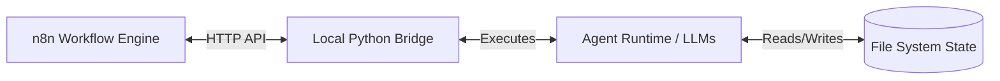
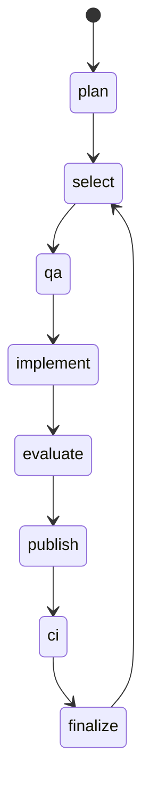

# Workflow architecture

The orchestrator uses a state machine backed by files. This document describes the bridge, stored state, and orchestration loop.

## 1. High-Level Architecture

The workflow runs through these components:

1.  **n8n:** Runs in a Docker container and hosts the "GW2 - Development Pipeline" workflow. It handles workflow visualization, retries, and timing.
2. **Local bridge (Python):** Runs on the host machine alongside the repository. n8n reads state with `GET /cycle`, requests the next step with `POST /cycle/step`, and checks Claude usage with `POST /budget`. These endpoints require a bearer token. The bridge runs one task at a time; a new step request re-attaches to an existing running step.
3.  **The Agent Runtime (Python/LLMs):** Code under `agent/runtime/` builds prompts, calls the LLM CLIs (`claude` and `codex`), parses outputs, and updates files such as `BACKLOG.md`.

## 2. Stored state

The runtime stores workflow state in files:

* **Bridge state file:** `GW2_BRIDGE_STATE` selects the location; the default is `%USERPROFILE%/.gw2-claude-bridge/tasks.json`, outside the repository. It stores task records and per-story cycle state, including the next phase, retry counters, changed paths, and published SHA.
*   **`agent/CURRENT_STORY.md`:** Points to the active story.
*   **`agent/stories/BACKLOG.md`:** The authoritative work index, parsed by `story_state.py` and maintained through `backlog_writer.py`.
*   **`agent/runtime/artifacts/`:** Stores JSON/Markdown outputs from the latest LLM runs (e.g., `PLANNING_RESULT.json`, `EVALUATOR_RESULT.json`) for debugging. These files are transient and ignored by Git.

The bridge uses the current-story pointer to find the relevant cycle record. A restart marks a running step interrupted, and the next run repeats that step. An interrupted implementation receives a continuation prompt and retains its recorded baseline. Recovery happens at step boundaries; it does not restore a model process at the instruction where it stopped. See [bridge recovery](../../local_bridge/README.md#recovering-by-hand) and [the state-file configuration](../../local_bridge/bridge.py).

## 3. The Orchestration Loop (Cycle Phases)

`local_bridge/cycle.py` defines the state machine and its phases:

The diagram shows the successful story path. `plan` is scheduled when needed, rather than before every story. The implementation in [`cycle.py`](../../local_bridge/cycle.py) handles the following cases:

| Step | Work and outcome |
| --- | --- |
| `plan` | Dispatches one actionable Architect Request first; otherwise runs the Planner. These are separate role invocations. Planning considers queue availability, changed inputs, completed stories, and a validated request for another planning batch. |
| `select` | Activates the first eligible `To Do` story. A new cycle starts at `qa`. An empty queue stops the run. |
| `qa` | Reuses a validated `READY` or justified `NO_TESTS_NEEDED` plan, or runs QA preparation. QA may write tests in approved roots. The harness saves the validated plan under `agent/qa-plans/`. |
| `implement` | Checks Claude capacity and runs the story or retry prompt. It records changed paths and restores protected tests, the QA plan, and lifecycle files afterwards. A missing plan sends the cycle back to `qa`. |
| `evaluate` | Runs read-only evaluation against the working tree and QA plan, plus conditional QA review. `COMPLETE` advances to publication; an actionable `RETRY` returns to coding. `BLOCKED` or `NEEDS_USER` blocks the story. |
| `publish` | Commits and pushes the recorded story paths, pending planning paths, and relevant lifecycle and QA files. It records the published SHA. A rejected push keeps this phase for another attempt. |
| `ci` | Checks GitHub Actions for that SHA. Relevant application failures return to coding within the CI-fix budget. Workflow-only failures are warnings. An unknown result or a failure outside story scope stops the run without starting Claude. If CI verification is unavailable, the current code records `SKIPPED` and advances. |
| `finalize` | Marks the story DONE, moves its backlog entry, clears the pointer, and commits and pushes those lifecycle updates. |

Blocking a story clears its active pointer so a later run can select independent work. Capacity exhaustion preserves the current phase. The [bridge guide](../../local_bridge/README.md) owns the full operating and recovery procedures.

## 4. Resource & Budget Throttling

A repeated failure can consume the available model usage budget.

`local_bridge/claude_budget.py` controls Claude usage:

* It reads Claude usage and checks both the five-hour session limit and a weekly cap before starting implementation.
* In automatic mode, daily shares unlock at the configured time and remain available until the weekly reset. Manual mode uses the configured percentage cap.
* When capacity is unavailable, `implement` returns `waiting_for_claude_budget` without advancing. The check does not stop a run already in progress.
* While Claude waits, the bridge can dispatch needed Planner or Architect work. Codex has its own capacity handling; it is not an unlimited fallback.

Evaluation retries, CI-fix attempts, and consecutive non-capacity Claude failures use separate limits in [`config.py`](../runtime/support/config.py). Exhausting one blocks the story with an intervention record. Budget settings and their calculation are described in the [Claude budget guide](../../local_bridge/README.md#claude-budget).

## 5. Security & Document Ownership

Document ownership is defined in `agent/runtime/support/config.py` and enforced by the Python harness.

* The Planner owns planning artifacts, including the roadmap and planner continuity. It may not change application source or answer Architect Requests.
* The Architect answers dispatched requests and owns architecture decision records. It does not create or prioritize implementation stories.
* QA may prepare tests in approved roots. The harness validates its changed-file boundary and persists the plan. Post-implementation QA review is read-only.
* The Evaluator uses a read-only sandbox. The coding agent may change implementation files, but the harness restores QA-owned tests and mechanical lifecycle state after the attempt.
* Python owns activation, completion, and backlog section transitions. `backlog_writer.py` validates canonical index entries before writing. The `User` section indexes open human requests and is not an executable story queue.

These protections use different mechanisms: sandbox restrictions for evaluation, snapshots and validation for writable roles, and restoration around coding attempts. The ownership table in [`config.py`](../runtime/support/config.py) and [runtime guide](../runtime/README.md) describe the boundaries.

## 6. Milestones and Roadmap Phases

The roadmap defines phases and exit criteria. Product requests, User Decisions, and architecture decisions also feed planning.

*   A specific "Phase N" in the roadmap maps directly to `milestone-NN` in the backlog.
*   The Planner is restricted to analyzing the *current* phase excerpt. It is not permitted to discover or redefine its own roadmap scope.
*   A milestone transition is only reported when the exit criteria defined in the roadmap for the current phase are fully satisfied, including project health reviews.

## 7. Git branch and documentation sync

In this branch's implementation, [`git_sync.py`](../runtime/support/git_sync.py) publishes the currently checked-out branch to the same branch on `origin`, without force-pushing. The bridge does not automatically select `agent/active-development` or pull `main`, and [`cycle.py`](../../local_bridge/cycle.py) has no `docs_sync` step. Maintainers must select the intended checkout and coordinate manual edits using the [bridge operating rules](../../local_bridge/README.md#rules-for-working-alongside-the-pipeline).
