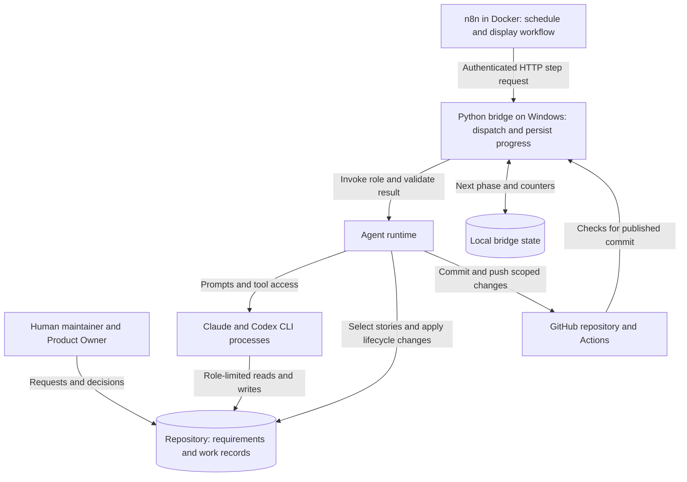

# Architecture and alternatives

## The system in plain terms

The workflow manages changes to a software product across multiple tasks. The human supplies product intent. A Planner turns that intent into stories: bounded tasks with acceptance criteria. QA prepares checks before coding. An Implementer changes the repository, and an Evaluator inspects the result. Python decides which task may run next and when its status may change.

This matters for a crafting application because a plausible result can still use the wrong domain rule. For example, a passing calculation test does not establish that the tested rule is the intended rule, or that the browser reaches that calculation. The design gives requirement questions, test preparation, and review explicit places in the workflow. It cannot make an incorrect specification correct.

### Components and communication

n8n is the scheduler and visible workflow. The bridge executes steps and stores their outcomes. The runtime provides the role runners, validation, QA, Git, and CI helpers. The bridge accepts one task at a time, so the outer workflow does not run competing coding agents against the same files. Each role can make several model requests and tool calls within its invocation.

The system combines a fixed outer workflow with agents that choose how to perform their assigned task. Using Anthropic's [workflow and agent terminology](https://www.anthropic.com/engineering/building-effective-agents), the outer structure is a coded workflow; its coding and planning steps contain agent loops. It also uses an evaluator/implementation feedback loop. These patterns do not require different model vendors or parallel execution.

For the actual stage dispatch, see [`cycle.py`](../../local_bridge/cycle.py) and [`bridge.py`](../../local_bridge/bridge.py). The [workflow diagrams](WORKFLOW_DIAGRAMS.md) show task flow and failure handling without the HTTP details.

## Why the responsibilities are separate

These are reasons for the mechanisms, not claims that they eliminate the underlying risks. [Design evolution](EVOLUTION.md) distinguishes documented incidents from architectural reasoning.

| Problem or constraint | Mechanism and reasoning | Cost or remaining limit |
| --- | --- | --- |
| Product rules must not be chosen for coding convenience. | The Planner defines bounded stories; the Implementer works within them. Product ambiguities require a human User Decision. Architecture questions use a separate Architect invocation. | A story can still misinterpret intent. Unnecessary questions delay work; a model can fail to recognize a real ambiguity. |
| A completion report is a claim about code. | A separate Evaluator reads the working tree, acceptance criteria, and QA plan. It can request concrete corrections without changing the implementation. | Review adds model usage and latency. Different roles or vendors do not establish statistically independent judgments; both can share a mistaken assumption. |
| Tests prepared after coding can merely confirm the chosen implementation. | QA prepares a persistent plan and may write tests first. The harness restores QA-owned tests and plan contents if coding changes them. | QA can choose weak tests or a wrong expectation. Restoration protects the agreed test contract, not its semantic correctness. Conditional read-only QA review handles disputed or insufficient verification. |
| Queue selection and status changes have precise rules. | Python checks eligibility and owns lifecycle changes. The Planner requests backlog additions, moves, and reordering through JSON `backlog_actions`; the writer derives and validates index entries. | Validation can check structure and dependencies, not prove that prioritization or acceptance criteria are good. The runtime itself needs maintained tests. |
| Long-running work can be interrupted or hit a usage limit. | Persisted phases and counters let the bridge resume at a step boundary. Capacity waits keep the phase; actual failures use separate retry budgets. | An interrupted step may run again. File and Git side effects require recovery handling; saving JSON does not provide a transaction over the whole workflow. |
| Maintainer edits can arrive while an agent is implementing. | The pipeline uses an `agent/dev` worktree. Between stories it merges `origin/master` and reviews incoming changes against their owning documents. | Branch isolation prevents sharing a working tree, not semantic or merge conflicts. Sync, review, and publication add code and operational failure modes. |

The separation is useful only while the additional checks catch enough relevant problems to justify their overhead. A read-only Evaluator cannot fix a defect itself; every correction requires another handoff. A narrow change can therefore spend more time in preparation and review than in coding.

## Comparing ways to do the same work

The comparison below is architectural analysis, not a benchmark. It compares configurations, rather than treating a product name as proof of one fixed design. A single agent can use durable files, tests, a sandbox, and CI. A multi-agent system can lack all of those. Agent count, persistence, permission boundaries, and who controls the sequence are separate choices.

| Approach | Advantages and suitable work | Disadvantages, complexity, and costs |
| --- | --- | --- |
| **One coding agent with human review** | Short handoffs and one continuing task context. Fits a bounded fix when a developer can define the task and inspect the diff. Testing and CI can remain external requirements. | The human carries task selection and final judgment. The same agent may repeat its assumptions when reviewing itself. Long sessions accumulate context; low agent count does not guarantee low usage. |
| **One coding agent inside a scripted test/retry loop** | Automates repeated execution without introducing every planning role. Fits a known queue of issues with clear tests. Explicit counters and persisted stages are possible. | Passing tests can miss an incorrect rule or unwired feature. Retry failures need classification to avoid spending usage on capacity or infrastructure problems. Scripts still require maintenance. |
| **A coder plus a separate reviewer** | Adds a distinct review pass and feedback without a full planning pipeline. Fits work where the human already supplies reliable task contracts. | Additional context loading and review calls. Review can miss defects or reject valid work. Someone must define the criteria, arbitrate disagreement, and cap retries. |
| **This repository's sequential, role-based workflow** | Carries work from roadmap planning to published stories. Gives product questions, pre-code QA, repository review, recovery, and document reconciliation explicit owners. | More stages, files, validators, CLI integration, and n8n operations. Handoffs can lose context. Stories run serially, so separate roles do not provide coding throughput through parallelism. |
| **A manager agent delegating to workers** | Can discover subtasks dynamically and run independent investigation or implementation in parallel. Fits work whose decomposition is not known beforehand. | Delegation and synthesis consume context and model calls. Concurrent writers need separate workspaces and integration rules. A manager can delegate badly or combine individually plausible but incompatible answers. |

For a concrete example of checks in a simpler coding tool, [Aider supports configured lint/test commands and attempts to repair failures](https://aider.chat/docs/usage/lint-test.html). Those capabilities are not exclusive to a multi-role pipeline. The manager/worker and evaluator feedback patterns are described in [Anthropic's pattern guide](https://www.anthropic.com/engineering/building-effective-agents); the suitability judgments in the table are our analysis of their consequences for this repository.

### Custom runtime versus a framework

This repository implements its own state machine around CLI processes and Git files. That makes story ownership, publication scope, and dependency rules directly inspectable in local Python code. It also makes this project responsible for maintaining persistence, result parsing, retries, process recovery, and framework-like glue.

A graph or workflow framework could host a similar sequence. [LangGraph provides checkpointers and stores](https://docs.langchain.com/oss/python/langgraph/persistence); durable recovery depends on the selected backend, and its in-memory checkpointers do not survive a restart. [CrewAI Flows supports state and persistence through `@persist`](https://docs.crewai.com/en/concepts/flows#flow-persistence). It is inaccurate to describe either alternative as inherently an in-memory conversation that loses all progress.

A framework would provide reusable orchestration facilities and introduce its own APIs, execution semantics, dependencies, and upgrades. It would not supply this repository's product authority, protected-test policy, backlog schema, or Git publication rules automatically. Moving to one would relocate some runtime work and still require those project-specific contracts. n8n is already a workflow framework here; the custom Python layer is where the repository-specific policy lives.

### Cost and latency

A fresh behavior story normally invokes QA, implementation, and evaluation. Planner and Architect runs are conditional; so are sync review and post-implementation QA review. A retry repeats some of those stages. Each invocation may contain multiple requests, and each role needs enough context to do its job. A reused QA plan avoids a new preparation pass.

Splitting roles can reduce the information needed for any one task, while increasing repeated context across handoffs. Parallel workers can reduce elapsed time for independent subtasks while increasing simultaneous usage and integration work. Local inference trades hosted usage for local compute and operation; a smaller model may also need more correction attempts. None of these choices has a universal cost ranking.

The current implementation checks Claude's session and weekly allowance before a coding run. It does not reserve the entire run's capacity or stop it at the threshold. Codex has separate capacity handling. Waiting for allowance, CI, or a human decision can dominate elapsed time even when no model is running. Subscription allowance, model tokens, elapsed time, and maintenance effort are different costs; this repository has no like-for-like result proving the full pipeline cheaper or more accurate than the alternatives above.

## Documentation ownership is part of the design

Two different questions matter: **where does a fact belong**, and **who may change that file**? The [documentation map in `CLAUDE.md`](../../CLAUDE.md#documentation-map) answers the first. [`DOCUMENT_OWNERSHIP` in `config.py`](../runtime/support/config.py) and the role contracts define write authority. This overview is a reading guide, not a second permission table.

| Reader's question | Authoritative home |
| --- | --- |
| What should the product do, and what should its player-facing terms mean? | [Domain specification](../../docs/DOMAIN_SPEC.md) and [crafting glossary](../../docs/crafting/GLOSSARY.md). |
| What exists now, and what architecture is intended? | [Current state](../../docs/CURRENT_STATE_SPEC.md), [current architecture](../../docs/CURRENT_ARCHITECTURE.md), and [target architecture](../../docs/TARGET_ARCHITECTURE.md). Current implementation alone does not decide intended behavior. |
| What work remains, and what does one task require? | [Roadmap](../../docs/ROADMAP.md), [known problems](../../docs/KNOWN_PROBLEMS.md), [backlog index](../stories/BACKLOG.md), and the linked story contracts. [Project state](../PROJECT_STATE.md) carries Planner continuity. |
| What standards apply to implementation and verification? | [Coding guidelines](../../docs/CODING_GUIDELINES.md), [test strategy](../../docs/TEST_STRATEGY.md), and the story's [persistent QA plan](../qa-plans/README.md). |
| Who decided an unresolved question? | [User Decisions](../user-decisions/), [Architect Requests](../architect-requests/), and [architecture decision records](../../docs/architecture/decisions/). |

Keeping intended and observed behavior separate is necessary when they disagree. A maintainer may intentionally change code without updating its descriptive documentation. The sync review can reconcile a stale description; it may not silently rewrite an authoritative domain rule or target decision to match the code. It raises the appropriate question instead. Copying the same rule into several overviews would create more places for disagreement.

The harness alone changes the active-story pointer and mechanical status transitions. The Planner can maintain the roadmap within its contract, but cannot resolve human decisions or act as the Architect. QA can write tests in approved roots; the Evaluator is read-only. The documentation sync review has its own bounded write policy in [`sync_review.py`](../runtime/core/sync_review.py). These are different permissions, not a single rule that every non-coding role is read-only.

## Implementation details and limits

### State and recovery

| Record | Purpose and lifetime |
| --- | --- |
| Bridge `tasks.json` | Task records, next phase, retry counters, changed paths, and published SHA. `GW2_BRIDGE_STATE` selects the path; the default is `%USERPROFILE%/.gw2-claude-bridge/tasks.json`, outside Git. |
| `CURRENT_STORY.md` and `BACKLOG.md` | Tracked active-story pointer and queue index. Eligibility also checks the canonical story and its prerequisites. |
| `agent/qa-plans/` | Tracked QA contracts and review records used across coding attempts. |
| `agent/runtime/artifacts/` | Ignored generated prompts, results, and backups for the current runtime. These are not authoritative requirements. |
| `agent/logs/` | Tracked append-only daily operational history, separate from generated artifacts. |

An n8n wait can re-attach to a still-running bridge task. A bridge restart instead interrupts that task; a later run repeats the step. Interrupted coding receives a continuation prompt and keeps its captured baseline. Completion requires a usable verdict, publication, and the CI step; the code allows CI verification to be `SKIPPED` when unavailable, so DONE is not an unconditional guarantee of a passing CI run. The [bridge guide](../../local_bridge/README.md) owns the operating and recovery procedures.

### Branch integration and document review

The normal launcher uses the separate `agent/dev` worktree. Between stories, `sync` merges `origin/master`, at most once per 30-minute interval. A merge conflict is aborted and stops the run; a merge that would overwrite uncommitted work is deferred. Incoming changes beyond the dependency-only filter receive a bounded Codex `review` pass. It can update approved descriptive docs, open decisions or architecture requests, record problems, and give findings to the Planner. It cannot change application code or settle a product contradiction. Two invalid review attempts leave a workflow warning and the range for Planner attention.

After scoped publication and the CI step, finalization records DONE and pushes lifecycle updates on the agent branch, then attempts to fast-forward `master`. If `master` moved incompatibly, the push is rejected without force; the story remains complete on the agent branch and a warning records the outstanding integration. The next sync and story can carry both histories. This is branch publication, not proof of deployment to a running application.

The most useful code entry points are [`choose_step()` and stage functions](../../local_bridge/cycle.py), [Git synchronization](../runtime/support/git_sync.py), [sync review](../runtime/core/sync_review.py), [backlog actions](../runtime/core/backlog_writer.py), and [QA/evaluation details in the runtime guide](../runtime/README.md). The [bridge guide](../../local_bridge/README.md#branches) covers the actual worktrees and commands.
