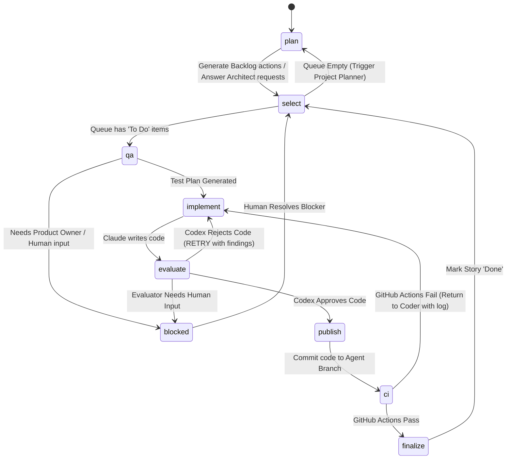
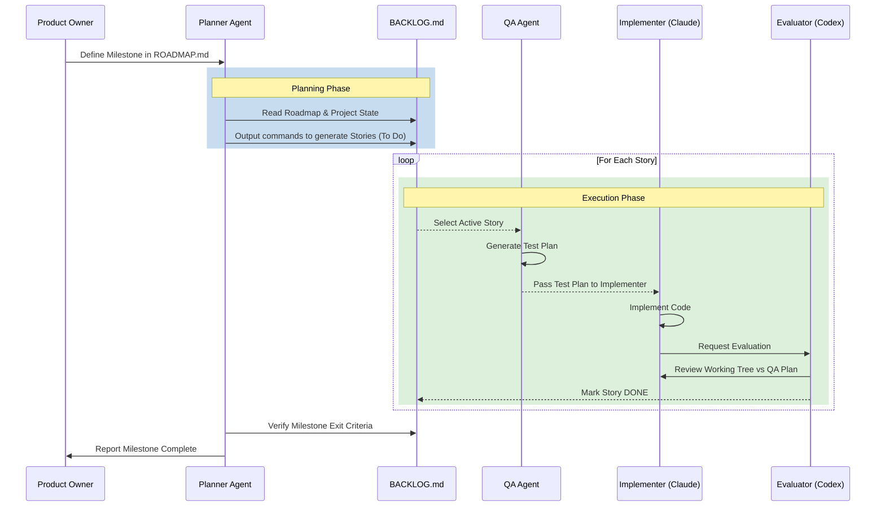
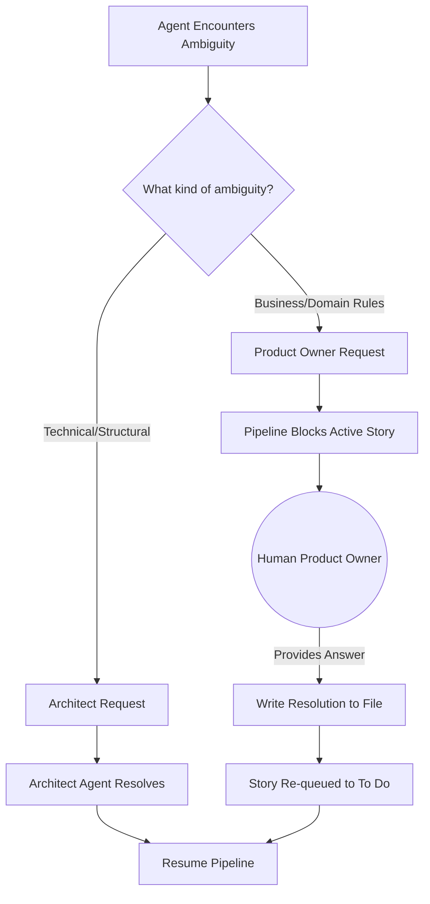

# Workflow Diagrams

These diagrams show the development cycle, milestone processing, and handling of unresolved questions.

## 1. The Core SDLC Cycle

The local bridge and n8n run this loop. Transitions are defined in `local_bridge/cycle.py`.

## 2. Milestone without retries or blockers

This sequence shows a milestone moving from roadmap planning through story execution to completion.

## 3. Human Intervention / User Decisions

Architecture questions go to the Architect. Unresolved product rules require a human decision.

