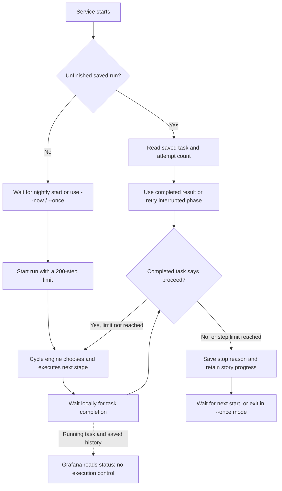
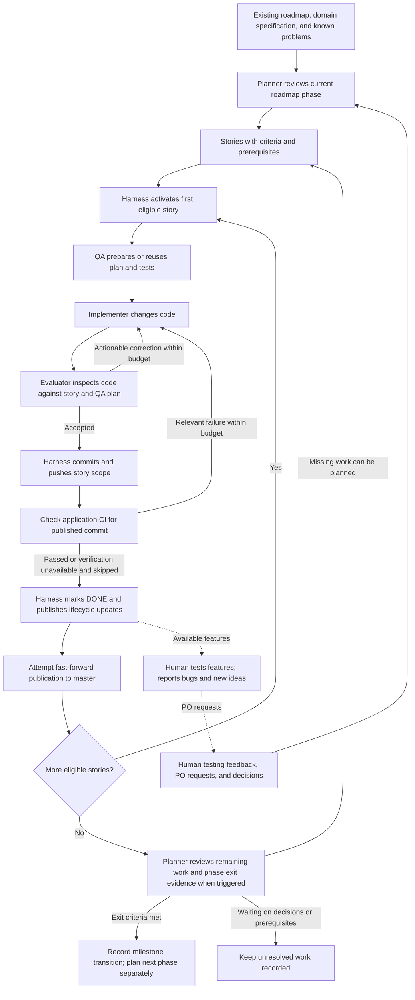
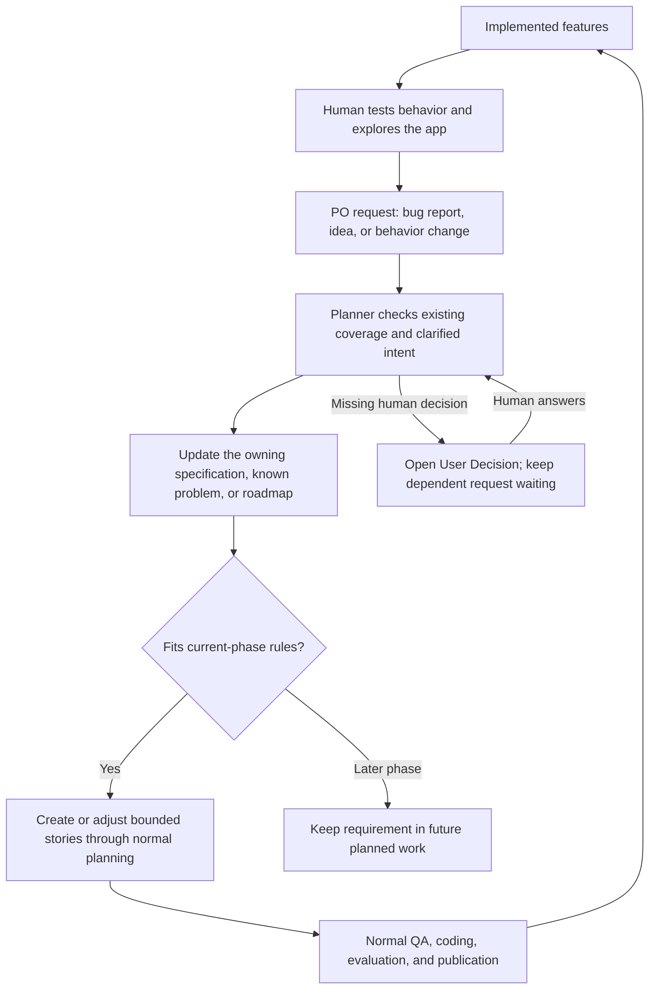
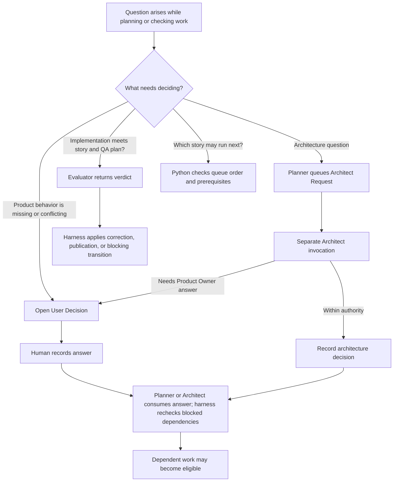
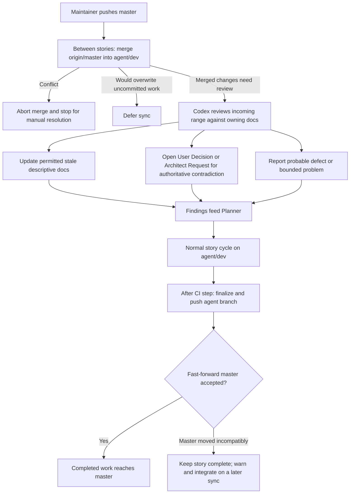

# How work moves through the system

Start with the milestone diagram for the overall process. The decision diagram explains who may settle a question; the failure diagram distinguishes correction, waiting, and blocking. The [architecture diagram](ARCHITECTURE.md#components-and-communication) shows the host processes and their connections.

## Starting, continuing and stopping a run

The Python runner supplies the outer loop; the existing cycle engine chooses the actual stage.
This is the implemented replacement for n8n, with a separate [live cutover](../../local_bridge/README.md#cutover-from-n8n).

Nightly starts are hourly at `:35` from `17:35` through `06:35`, in the host's local timezone.
The window controls starts, not when an active run must stop. Waiting polls do not consume the
step limit. Scheduled starts during a busy run are skipped; missed starts while the service is
off are not replayed. Restarting an unfinished run preserves its attempt count, even outside the
start window. If a sync changes Python workflow code, the launcher restarts the service before
another stage runs. Ctrl+C allows the current step to finish before shutdown.

Grafana can be unavailable without interrupting this loop. Its boxes and arrows describe stage
activity; the Python engine still decides every transition. The [architecture guide](ARCHITECTURE.md#execution-and-visibility)
explains how the display relates to saved state and what it cannot show.

## From the existing roadmap to a completed milestone

A story is one implementation task. The rough milestones and initial specifications were established before the automated workflow began. A milestone contains several stories and has its own exit criteria; its details can be refined as work approaches. The loop below runs through one bridge task at a time. Planning and architecture calls occur when needed, not before every coding attempt.

DONE is a harness transition, not the Evaluator's own file edit. CI verification can be explicitly skipped when unavailable; the code does not make a passing CI result unconditional. A rejected push to `master` leaves a warning and the completed story on `agent/dev`. Neither a milestone transition nor a branch push means the application has been deployed.

## Human testing and scope changes

Automated implementation lets the maintainer spend more time testing implemented features. Product Owner requests are the input channel for resulting bug reports, ideas, and changes of direction. They can change or expand the app's scope while development continues. A request does not automatically create a milestone or override current-phase rules.

The Planner's resolution links a processed request to its authoritative documentation and planned work. User Decisions ask the human to settle a question; User Interventions ask for attention when automatic execution cannot proceed. Those records support human control in both directions: steering the product and responding to the workflow. Replanning still has to preserve consistent requirements and dependency order.

## Who makes which decision?

The human owns product intent. The Architect can settle technical architecture questions within its authority. Python owns eligibility and lifecycle transitions. A blocked question prevents dependent work from running; it does not automatically freeze the whole milestone.

QA can open a product clarification through the normal User Decision flow. A coding/evaluation failure can also produce a User Intervention requiring human attention. These records have different owners; an Architect answer is not permission for a model to resolve a User Decision. [Role contracts and ownership](ARCHITECTURE.md#documentation-ownership-is-part-of-the-design) define the exact boundaries.

## Failure does not always mean another coding attempt

| Additional case | Behavior and reason |
| --- | --- |
| Invalid QA plan | Bounded correction retry with validation feedback. A QA technical failure blocks the story with a failure report; it does not invent a Product Owner question. |
| Evaluator cannot return a usable verdict | The evaluation phase is retained for recovery. A completed coding attempt does not need to be rerun just to obtain a verdict. |
| Coding changes protected tests, plan, or lifecycle files | The harness restores them and reports the finding. This can trigger independent read-only QA review. |
| Agent-runtime CI job fails | Recorded as a workflow warning separately from application acceptance. |
| Documentation sync review fails twice | The range and failure are handed to planning, with a workflow warning. |
| Grafana stops or cannot query the service | Execution continues; the dashboard shows a query error or is unavailable. A monitoring outage does not itself create a story failure. |
| Python run reaches its 200-step guard | The run stops with a saved reason. It does not automatically block the story or spend a Claude failure retry. |

Claude allowance is the maintainer's current bottleneck on the reported $20 plan. Codex allowance is not currently a constraint; needed Codex planning and architecture work can continue while Claude waits. The runtime can also preserve a phase for other capacity exceptions, but the two allowances are not equal operating problems in this setup. Reducing Claude consumption remains under investigation.

These diagrams omit internal validation attempts. Separate counters exist for evaluation-driven coding retries, CI fixes, and consecutive non-capacity Claude failures; the outer run's step limit is another guard. The [service guide](../../local_bridge/README.md) owns exact limits, outcomes, and recovery commands; the [runtime guide](../runtime/README.md) explains completed-attempt preservation and QA protection.

## How maintainer and agent work meet

The normal setup keeps maintainer edits on `master` and pipeline edits in the separate `agent/dev` worktree. Sync runs only between stories and when its interval is due. A review is needed when incoming files are not limited to the dependency-only filter.

The sync reviewer does not choose a new product rule to make code and documentation agree. It can repair an approved description of an intentional change; a conflict with a binding specification goes to its decision owner. The [architecture guide](ARCHITECTURE.md#branch-integration-and-document-review) links the implementation and operating rules.
