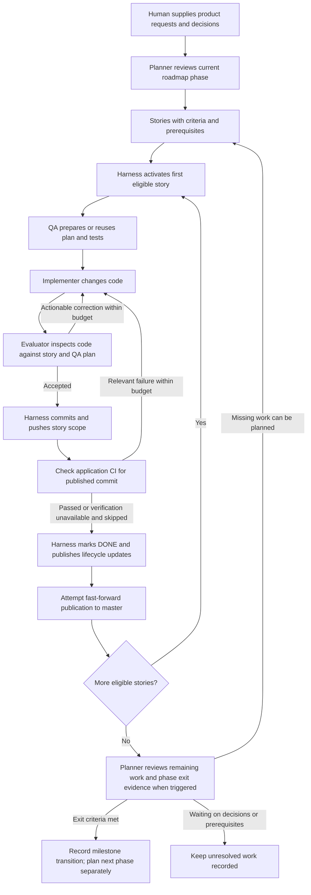
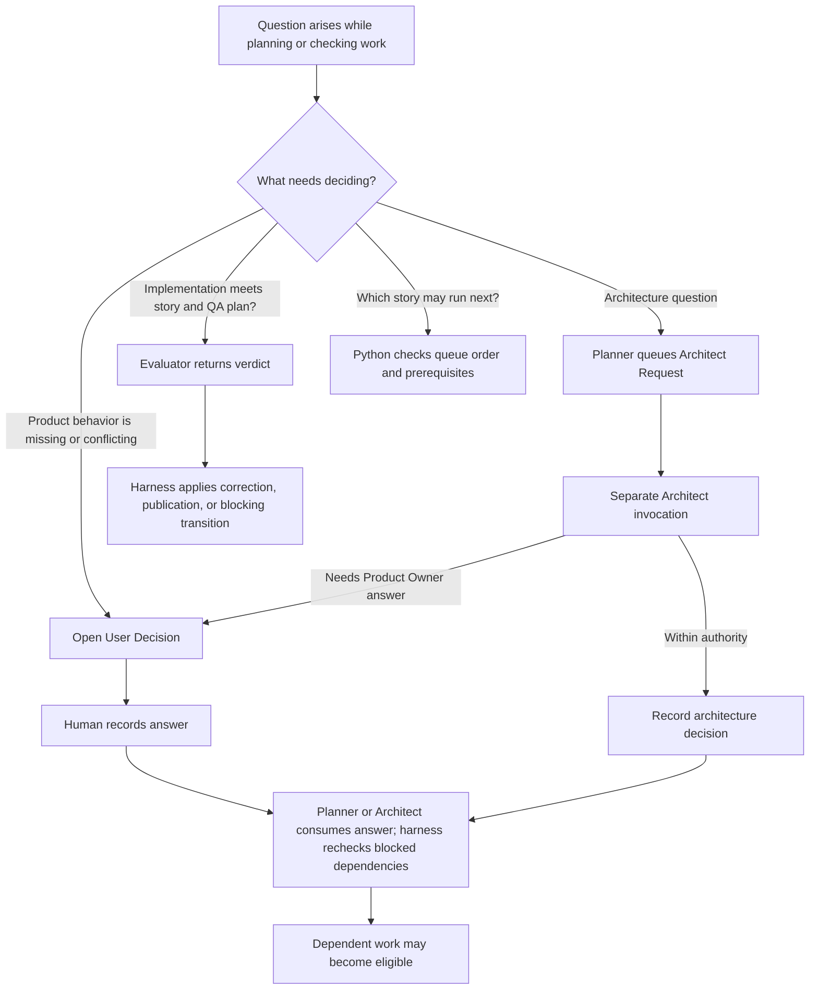
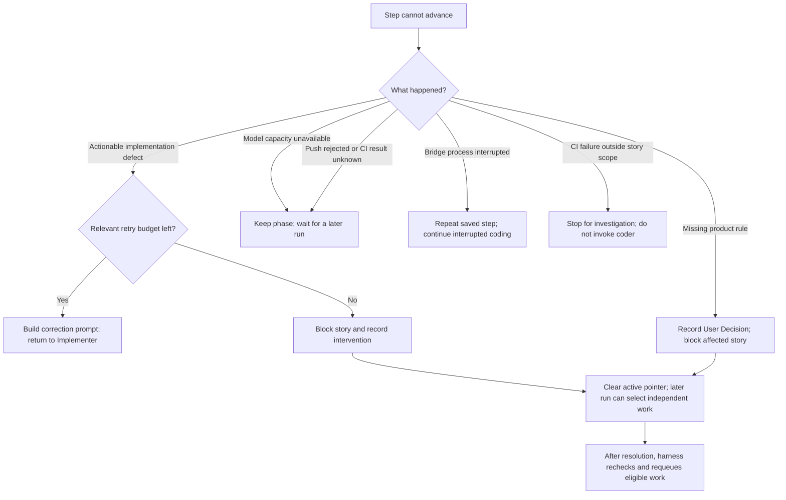
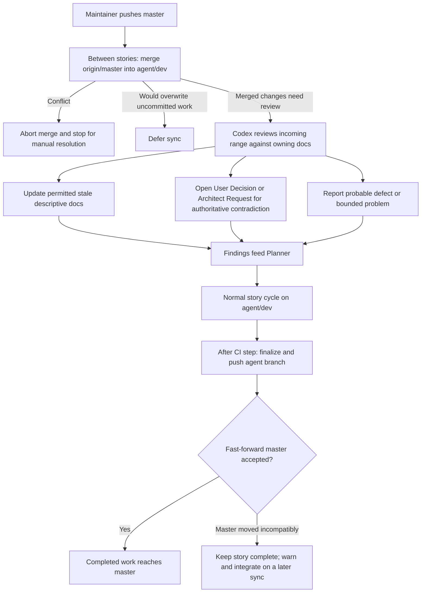

# How work moves through the system

Start with the milestone diagram for the overall process. The decision diagram explains who may settle a question; the failure diagram distinguishes correction, waiting, and blocking. The [architecture diagram](ARCHITECTURE.md#components-and-communication) shows the host processes and their connections.

## From product request to completed milestone

A story is one implementation task. A milestone contains several stories and has its own exit criteria. The loop below is run through one bridge task at a time. Planning and architecture calls occur when needed, not before every coding attempt.

DONE is a harness transition, not the Evaluator's own file edit. CI verification can be explicitly skipped when unavailable; the code does not make a passing CI result unconditional. A rejected push to `master` leaves a warning and the completed story on `agent/dev`. Neither a milestone transition nor a branch push means the application has been deployed.

## Who makes which decision?

The human owns product intent. The Architect can settle technical architecture questions within its authority. Python owns eligibility and lifecycle transitions. A blocked question prevents dependent work from running; it does not automatically freeze the whole milestone.

QA can open a product clarification through the normal User Decision flow. A coding/evaluation failure can also produce a User Intervention requiring human attention. These records have different owners; an Architect answer is not permission for a model to resolve a User Decision. [Role contracts and ownership](ARCHITECTURE.md#documentation-ownership-is-part-of-the-design) define the exact boundaries.

## Failure does not always mean another coding attempt

| Additional case | Behavior and reason |
| --- | --- |
| Invalid QA plan | Bounded correction retry with validation feedback. A QA technical failure blocks the story with a failure report; it does not invent a Product Owner question. |
| Evaluator cannot return a usable verdict | The evaluation phase is retained for recovery. A completed coding attempt does not need to be rerun just to obtain a verdict. |
| Coding changes protected tests, plan, or lifecycle files | The harness restores them and reports the finding. This can trigger independent read-only QA review. |
| Agent-runtime CI job fails | Recorded as a workflow warning separately from application acceptance. |
| Documentation sync review fails twice | The range and failure are handed to planning, with a workflow warning. |

These diagrams omit internal validation attempts and transport details. Separate counters exist for evaluation-driven coding retries, CI fixes, and consecutive non-capacity Claude failures. The [bridge guide](../../local_bridge/README.md) owns exact limits, outcomes, and recovery commands; the [runtime guide](../runtime/README.md) explains completed-attempt preservation and QA protection.

## How maintainer and agent work meet

The normal setup keeps maintainer edits on `master` and pipeline edits in the separate `agent/dev` worktree. Sync runs only between stories and when its interval is due. A review is needed when incoming files are not limited to the dependency-only filter.

The sync reviewer does not choose a new product rule to make code and documentation agree. It can repair an approved description of an intentional change; a conflict with a binding specification goes to its decision owner. The [architecture guide](ARCHITECTURE.md#branch-integration-and-document-review) links the implementation and operating rules.
