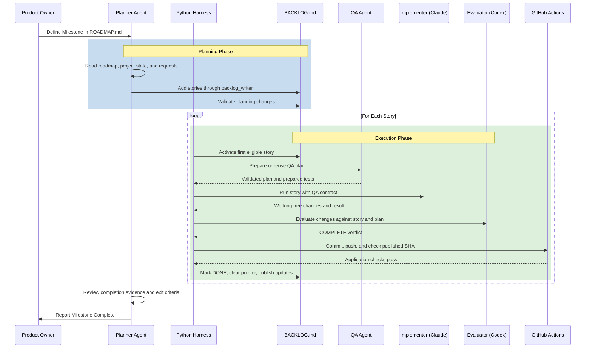
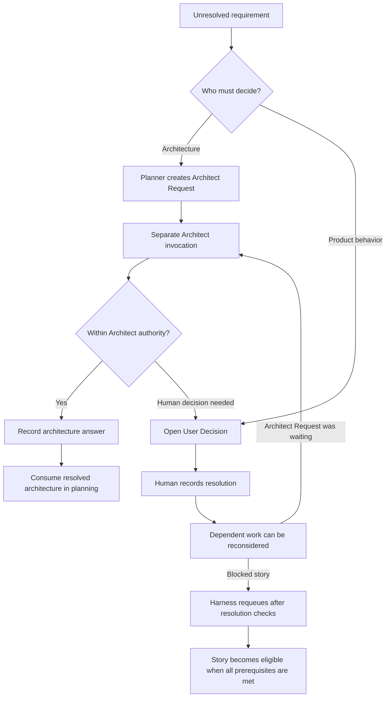

# Workflow Diagrams

These diagrams show the development cycle, milestone processing, and handling of unresolved questions.

## 1. The Core SDLC Cycle

The local bridge and n8n run this loop. Transitions are defined in [`cycle.py`](../../local_bridge/cycle.py). Planning runs when triggered, with actionable Architect Requests dispatched before a Planner pass. The diagram omits transport errors and internal correction retries; the [bridge guide](../../local_bridge/README.md) describes those outcomes.

```mermaid
stateDiagram-v2
    [*] --> dispatch
    dispatch --> plan: Planning or architecture work needed
    dispatch --> select: No background work needed
    plan --> dispatch: Validated pass completed
    plan --> stopped: Planning failed after correction retry
    select --> qa: Activate first eligible story
    select --> stopped: No eligible story
    qa --> implement: READY or NO_TESTS_NEEDED plan
    qa --> blocked: Product decision or QA technical failure
    implement --> qa: QA plan missing
    implement --> implement: Capacity wait or interrupted attempt
    implement --> evaluate: Coding attempt completed
    implement --> blocked: Consecutive failure budget exhausted
    evaluate --> publish: COMPLETE
    evaluate --> implement: Actionable RETRY within budget
    evaluate --> blocked: BLOCKED, NEEDS_USER, or retries exhausted
    publish --> ci: Push succeeded and SHA recorded
    publish --> publish: Publication failed; rerun later
    ci --> finalize: PASSED or verification SKIPPED
    ci --> implement: Relevant failure within CI-fix budget
    ci --> ci: Result unknown or failure outside story scope
    ci --> blocked: CI-fix budget exhausted
    finalize --> dispatch: Mark DONE and publish lifecycle updates
    blocked --> stopped: Clear pointer; later run can select other work
```

Wait loops mean that the phase is preserved for a later run; they do not mean continuous model calls. A resolved decision or intervention is requeued by the harness before selection. Agent-workflow CI failures are reported separately from application checks.

## 2. Milestone without retries or blockers

This sequence shows responsibilities on a successful path. Python activates and finalizes stories; the Evaluator supplies a verdict. Milestone completion is a later Planner review against roadmap exit criteria.

## 3. Human Intervention / User Decisions

The Planner queues architecture questions for a separate Architect invocation. Product questions require human answers in User Decisions. QA clarification blocks its story, while independent work can continue. The [role router](../../AGENTS.md), [QA contract](../qa-plans/README.md), and [runtime guide](../runtime/README.md) define these boundaries.

